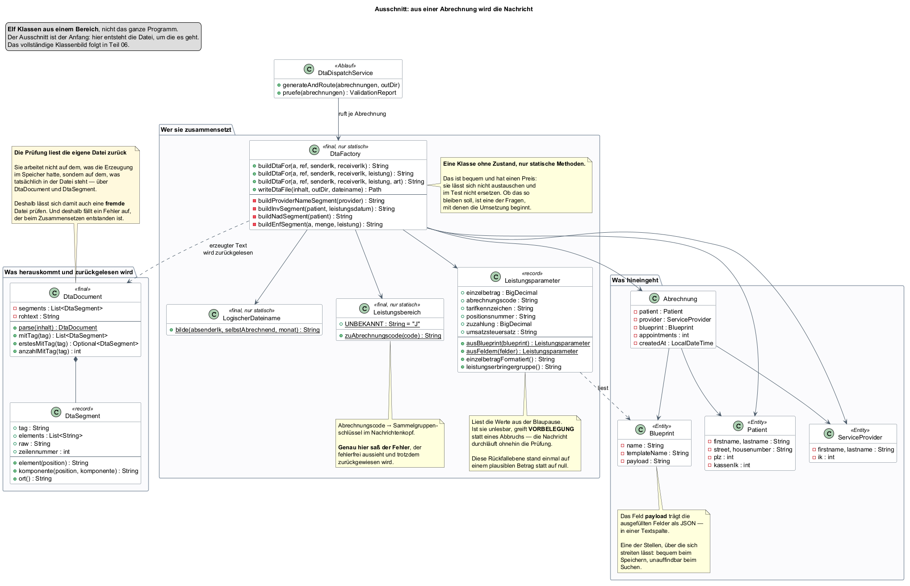

## Ausgangslage

Der Aufbau einer Lieferung steht (Teil 11): Segmente, Felder, Schachtelung,
Zähler — maschinenlesbar in den JSON-Beschreibungen und als Bild im
Aufbaudiagramm. Was fehlt, ist der Schritt dazwischen. Das Programm weiß
inzwischen, **wie** eine Nachricht aussieht; es hat noch keine erzeugt.

Auf der einen Seite liegen Stammdaten: eine Teilnehmerin mit
Versichertenkennzeichen, eine Hebamme mit Institutionskennzeichen, eine
Blaupause mit dem Preis je Termin, eine Zahl wahrgenommener Termine. Auf der
anderen Seite steht eine Textdatei, in der jedes Zeichen eine vereinbarte
Bedeutung hat. Dieser Teil beschreibt den Weg von dort nach hier.

## Ziel dieses Teils

Aus einer Abrechnung eine vollständige Lieferung erzeugen — und zwar so, dass
sich später **nachvollziehen lässt, woher jede einzelne Angabe kommt**. Das ist
die eigentliche Anforderung: Eine Datei, die stimmt, deren Zustandekommen aber
niemand erklären kann, ist im Streitfall wertlos.

## Überlegungen

### Wer setzt welchen Wert

Die Felder einer Lieferung fallen in drei Gruppen, und die Unterscheidung
entscheidet über den ganzen Entwurf:

| Herkunft | Beispiele | Wer bestimmt sie |
|---|---|---|
| **Stammdaten** | Name, Geburtsdatum, Institutionskennzeichen | die Anwenderin, einmal erfasst |
| **Abrechnungsdaten** | Terminzahl, Einzelbetrag, Positionsnummer | die Anwenderin, je Lauf oder je Blaupause |
| **Abgeleitete Werte** | Summen, Segmentzähler, laufende Nummern, Dateiname | die Anwendung, aus den ersten beiden |

Nur die ersten beiden Gruppen dürfen erfragt werden. **Ein Feld, das die
Anwendung ohnehin berechnet und trotzdem im Formular steht, ist eine Falle**:
Die Eingabe wird entgegengenommen und verworfen, und wer den Unterschied
zwischen Eingabe und Ergebnis bemerkt, sucht den Fehler an der falschen Stelle.
Dieses Projekt hatte den Fall — die Summenfelder standen in den
Segmentbeschreibungen als ausfüllbar, obwohl sie beim Erzeugen berechnet
werden.

### Eine Vorlage füllen oder eine Nachricht bauen

Zwei Wege lagen nahe.

Der erste: **die Segmentbeschreibungen aus Teil 11 als Vorlage nehmen** und
Feld für Feld befüllen. Das klingt folgerichtig, weil die Beschreibung ohnehin
vorliegt. Es hat einen Haken, der erst beim Hinsehen auffällt: Die Beschreibung
sagt, *welche Felder es gibt*, nicht, *in welcher Reihenfolge Nachrichten
verschachtelt sind* und *welcher Zähler worauf zählt*. Ein Erzeuger, der nur
Felder füllt, müsste die Schachtelung trotzdem kennen — sie stünde dann an zwei
Stellen.

Der zweite: **die Nachricht ausformulieren**, Segment für Segment, in der
Reihenfolge, die die Anlage vorgibt. Die Beschreibung bleibt, wofür sie gemacht
ist: für das Formular und für die Prüfung.

### Der Rückfallwert ist die eigentliche Entscheidung

Jedes Feld braucht eine Antwort auf die Frage: *Was steht hier, wenn die Angabe
fehlt?* Drei Möglichkeiten gibt es, und die Wahl zwischen ihnen ist keine
Geschmacksfrage.

**Abbrechen.** Die Erzeugung schlägt fehl, sobald etwas fehlt. Sauber, aber im
Betrieb unbrauchbar: Eine Abrechnung über fünfzehn Teilnehmerinnen bricht dann
an der ersten fehlenden Hausnummer ab, ohne zu sagen, was sonst noch fehlt.

**Einen plausiblen Wert einsetzen.** Bequem und **die gefährlichste der drei**.
Ein erfundenes Geburtsdatum geht an die Kasse und sieht dort echt aus. Dieses
Projekt hatte beide Fälle: einen Ersatz-Geburtstag und einen Ersatz-Einzelbetrag
aus einer Beispieldatei. Der zweite hat jede Rechnung auf denselben Betrag
lauten lassen — und weil die Datei in sich stimmig war, hielt sie keine Prüfung
auf.

**Einen Wert einsetzen, der auffällt.** Das Feld bleibt leer oder steht auf
null, die Nachricht entsteht vollständig, und die **Prüfung vor dem Versand**
hält sie an. Der Fehler wird sichtbar, ohne dass die Erzeugung darüber
stolpert.

### Warum alles auf einmal erzeugt wird

Ein Lauf betrifft mehrere Teilnehmerinnen und mehrere Kassen. Man könnte jede
Nachricht erzeugen, prüfen und sofort zustellen. Dagegen spricht ein Fall, den
es wirklich gibt: Die fünfte Nachricht wird beanstandet, die ersten vier sind
schon draußen. Sie müssten bei der Kasse storniert werden — und eine Stornierung
ist ein eigenes Verfahren mit eigenen Anforderungen.

## Entscheidung

**Die Nachricht wird ausformuliert, nicht aus der Beschreibung gefüllt.** Ein
einziger Erzeuger setzt die Segmente in der vorgegebenen Reihenfolge
zusammen und rechnet dabei alle abgeleiteten Werte selbst aus. Die
Segmentbeschreibungen aus Teil 11 bleiben für Formular und Prüfung zuständig.

*Warum nicht der Vorlagenweg:* Er hätte die Schachtelung an zwei Stellen
gebraucht — in der Beschreibung und im Erzeuger. Zwei Abschriften derselben
Regel laufen auseinander, und zwar in der Richtung, die niemandem auffällt.

**Rückfallwerte fallen so aus, dass die Prüfung sie fängt.** Kein erfundenes
Datum, kein plausibler Betrag. Der Einzelbetrag fällt auf null, ein fehlendes
Geburtsdatum bleibt leer.

*Warum nicht der plausible Wert:* Er ist genau dann am schädlichsten, wenn
niemand hinsieht. Eine Abrechnung, die nicht losgeht und sagt warum, ist besser
als eine, die mit einer erfundenen Angabe losgeht.

**Erst alle erzeugen und prüfen, dann zustellen.** Eine einzige beanstandete
Nachricht hält den ganzen Lauf auf.

*Warum nicht einzeln:* Weil ein halb zugestellter Lauf schlimmer ist als ein
gar nicht zugestellter.

**Was nur einmal vergeben werden darf, kommt aus der Datenhaltung.** Die
laufende Nummer der Übermittlung und die Rechnungsnummer werden gesperrt
gezogen und dauerhaft festgehalten — nicht aus einem Zähler, der beim
Programmstart wieder bei eins beginnt.

*Warum nicht im Arbeitsspeicher:* Eine doppelt vergebene Übermittlungsnummer
ist ein dokumentierter Abweisungsgrund. Die zweite Abrechnung eines Monats
trüge dieselbe wie die erste.

## Ergebnis

Aus einer Abrechnung entsteht eine vollständige Lieferung: ein Umschlag mit
laufender Nummer, darin die Gesamtaufstellung mit Summen und die
Leistungsaufstellung mit dem Einzelfall.

Die Zuständigkeiten sind getrennt:

| Baustein | Aufgabe |
|---|---|
| **Leistungsparameter** | liest Betrag und Schlüssel aus der Blaupause; kennt die Rückfallwerte |
| **Absender** | unterscheidet, *wer geleistet hat*, von *wer schickt* |
| **Logischer Dateiname** | bildet die elf Stellen nach der Vorgabe, nicht frei |
| **Rechnungsangaben** | Rechnungs- und Belegnummer, samt Bezug bei einer Korrektur |
| **Erzeuger** | setzt daraus die Segmente zusammen und rechnet die Summen |

Zwei Stellen verdienen einen eigenen Blick.

**Summen und Mengen entstehen aus derselben Zahl.** Der Betrag in der
Leistungszeile ist gerundet; die Kasse multipliziert genau diesen gerundeten
Betrag mit der Menge. Wer die Fallsumme dagegen aus dem ungerundeten rechnet,
bekommt eine Abweichung von einem Cent — und die eigene Prüfung hält daraufhin
den ganzen Lauf auf, mit einer Meldung, die den Grund nicht nennt.

**Der Leistungsbereich im Umschlag wird abgeleitet, nicht gesetzt.** Er ergibt
sich aus dem Abrechnungscode der Leistungszeile. Das Projekt hatte dort lange
einen festen Buchstaben stehen, der zu einem anderen Beruf gehörte — die
Lieferung wäre angenommen und zurückgewiesen worden, nicht bezahlt.

## Offen geblieben

- **Die Prüfung selbst** ist hier nur als Tor erwähnt, nicht beschrieben. Sie
  ist der Gegenstand von Teil 14.
- **Der Weg zur Kasse** — an welche Stelle die fertige Datei geht und wie sie
  dorthin kommt — bleibt offen bis Teil 16. Erzeugen und Zustellen sind
  bewusst getrennt.
- **Die Auftragsdatei**, die eine echte Übermittlung begleitet, fehlt. Ihre
  Beschreibung liegt dem Projekt nicht vor; ohne sie ließe sich der
  physikalische Dateiname nur raten. Das ist keine Lücke im Entwurf, sondern
  eine in den Unterlagen — und sie wird so lange offen benannt, bis sie
  geschlossen werden kann.
